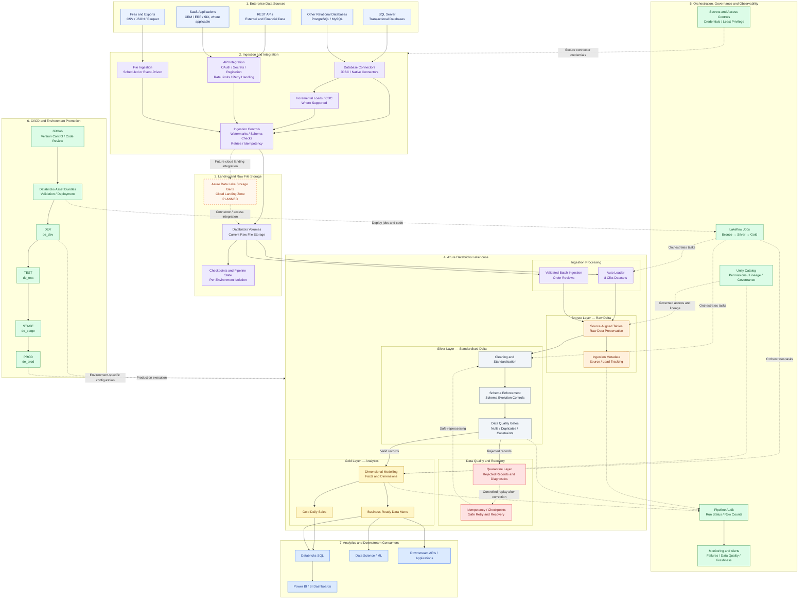
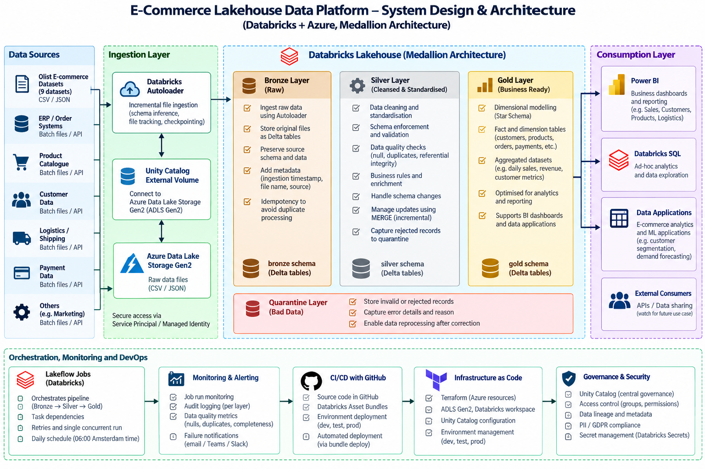
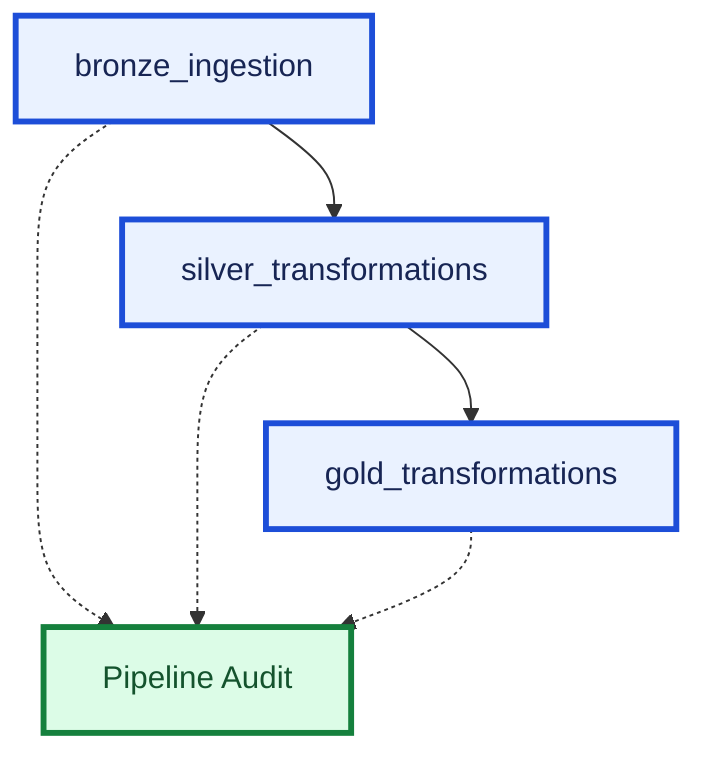

# Production-Grade E-Commerce Lakehouse on Azure Databricks

**An end-to-end data engineering project implementing a Medallion Architecture with Apache Spark, Delta Lake, Databricks Auto Loader, Unity Catalog, and Lakeflow Jobs.**

### End-to-end data flow

## End-to-End Enterprise Lakehouse Architecture

The platform is designed to ingest data from multiple operational and external sources, process it through an Azure Databricks Lakehouse, and publish trusted analytical datasets for reporting and downstream applications.

The current implementation demonstrates the Olist e-commerce pipeline using Databricks-managed Volumes, Auto Loader, Delta tables, Medallion Architecture, data quality validation, quarantine handling, pipeline auditing, Lakeflow Jobs, and Databricks Asset Bundles across DEV, TEST, STAGE, and PROD.

The architecture also identifies the intended extension to enterprise source systems, including SQL Server, transactional databases, REST APIs, SaaS platforms, and Azure Data Lake Storage Gen2 (ADLS Gen2).

### Architecture diagram



### Engineering practices

| Area | Practice |
|---|---|
| Ingestion | Use appropriate database, API, or file connectors; support incremental extraction and CDC where available. |
| Reliability | Use idempotent writes, checkpoints, watermarks, retry policies, and controlled reprocessing. |
| Data quality | Enforce schemas, validate required fields, check duplicates and referential integrity, and quarantine invalid records. |
| Transformation | Use Bronze for raw ingestion, Silver for standardisation and validation, and Gold for analytical models. |
| Governance | Apply Unity Catalog permissions, data lineage, appropriate credential management, and least-privilege access. |
| Orchestration | Use Lakeflow Jobs to manage task dependencies, retries, concurrency, and execution order. |
| Observability | Record audit metrics, row counts, execution status, failures, data freshness, and quality results. |
| CI/CD | Use GitHub and Databricks Asset Bundles to validate and deploy code and job definitions across isolated environments. |
| Consumption | Expose curated Gold datasets to Databricks SQL, BI dashboards, and downstream analytical workloads. |

### Implementation status

- **Implemented:** Olist raw-file ingestion, Databricks Volumes, Auto Loader for eight datasets, validated batch ingestion for order reviews, Bronze/Silver/Gold transformations, quarantine, quality gates, audit logging, Lakeflow Jobs, and deployment targets for DEV, TEST, STAGE, and PROD.
- **Target architecture:** SQL Server and other database integrations, external API/SaaS connectors, CDC, and ADLS Gen2 as a cloud landing zone.
- **Production hardening:** Confirm environment-specific permissions, secret management, alert delivery, monitoring coverage, recovery procedures, and production scheduling before treating these controls as fully operational.

**Architecture principle:** Every source should use an appropriate connector and ingestion strategy, while the Lakehouse provides a consistent, governed, testable, and auditable path from raw data to trusted analytics.


**Architecture status:** The current development pipeline uses Databricks-managed volumes for raw files. ADLS Gen2 is the intended cloud landing-zone integration, but that integration is not yet implemented. The diagram distinguishes the planned integration from the existing workflow.

## Architecture



---
## Project Documentation

For a detailed explanation of the system architecture, data flow, Medallion layers, data modelling, data quality, orchestration, monitoring, and deployment, see the full technical documentation.

📘 **[Read the Project Technical Documentation](docs/PROJECT_DOCUMENTATION.md)**

## Table of Contents

- [Overview](#overview)
- [Business Problem](#business-problem)
- [Project Objectives](#project-objectives)
- [System Design and Architecture](#system-design-and-architecture)
- [Technology Stack](#technology-stack)
- [Data Sources](#data-sources)
- [Medallion Architecture](#medallion-architecture)
- [Data Modelling](#data-modelling)
- [Data Quality and Reliability](#data-quality-and-reliability)
- [Pipeline Orchestration](#pipeline-orchestration)
- [Monitoring and Audit Framework](#monitoring-and-audit-framework)
- [Repository Structure](#repository-structure)
- [Environment and Deployment](#environment-and-deployment)
- [Validation and Testing](#validation-and-testing)
- [Implementation Status](#implementation-status)
- [Future Enhancements](#future-enhancements)
- [Getting Started](#getting-started)
- [Author](#author)

---

## Overview

This project demonstrates the design and implementation of a production-oriented e-commerce lakehouse using Azure Databricks and Delta Lake.

The platform ingests historical e-commerce data, preserves source information, applies data-quality and business validation, transforms records into analytical datasets, and produces business-ready tables for reporting and analysis.

The architecture follows the **Medallion Architecture**:

- **Bronze:** Raw source ingestion and preservation.
- **Silver:** Data cleansing, standardisation, validation, and quarantine.
- **Gold:** Dimensional modelling, analytical facts, and business aggregations.

Databricks Lakeflow Jobs orchestrates the pipeline, while a central audit table records execution status, row counts, validation results, and execution duration.

The project uses the Brazilian Olist e-commerce dataset to model a realistic data engineering workflow involving customers, orders, products, sellers, payments, reviews, and delivery performance.

### Key capabilities

- Incremental file discovery using Databricks Auto Loader for eight datasets.
- Specialised batch ingestion and validation for multiline review CSV data.
- Delta Lake tables across Bronze, Silver, and Gold layers.
- Data-quality validation, quarantine handling, and referential-integrity checks.
- Dimensional modelling and separate fact tables for order items, payments, and reviews.
- Daily sales aggregation and delivery-performance metrics.
- Pipeline audit logging and validation status tracking.
- Lakeflow Job orchestration with task dependencies and retry configuration.
- Git-based version control and Databricks Asset Bundle deployment.

---

## Business Problem

E-commerce platforms generate data across multiple business domains, including customers, orders, products, sellers, payments, reviews, and logistics.

Without a structured data platform, these datasets can contain inconsistent schemas, incomplete records, duplicate keys, inconsistent business definitions, and relationships that are difficult to reconcile.

These issues affect reporting accuracy, operational visibility, and the reliability of downstream analytics.

This project addresses these challenges by building a structured lakehouse pipeline that transforms raw source datasets into validated, traceable, analytical data products.

The resulting platform supports questions such as:

- How do order volumes and sales values change over time?
- Which payment methods contribute the most payment value?
- How do delivery outcomes vary across orders?
- How are customer, product, and seller records represented in analytical models?
- Can data-quality issues be identified and traced through the pipeline?

---

## Project Objectives

1. Build a repeatable end-to-end data ingestion and transformation pipeline.
2. Implement Bronze, Silver, Gold, and Quarantine layers.
3. Apply schema validation, business rules, and data-quality gates.
4. Preserve traceability from source data through analytical outputs.
5. Build fact and dimension tables suitable for business intelligence.
6. Prevent incorrect joins from multiplying payment or order-item values.
7. Orchestrate dependent tasks using Databricks Lakeflow Jobs.
8. Record pipeline execution and validation results centrally.
9. Manage deployment configuration through Git and Databricks Asset Bundles.
10. Establish a foundation for incremental processing, recovery testing, and cloud production deployment.

---

## System Design and Architecture

The platform is organised into five logical areas:

1. Data sources.
2. Ingestion and storage.
3. Databricks lakehouse processing.
4. Consumption and analytics.
5. Orchestration, monitoring, DevOps, and governance.


---

## Technology Stack

| Category | Technologies | Purpose |
|---|---|---|
| Processing | Python, Apache Spark, PySpark | Distributed ingestion and transformations |
| Lakehouse | Azure Databricks, Delta Lake | Data processing and transactional tables |
| File ingestion | Databricks Auto Loader | Incremental file discovery and checkpointing |
| Data architecture | Medallion Architecture | Separation of raw, cleansed, and analytical data |
| Data modelling | Dimensional modelling, fact and dimension tables | Business-ready analytical structures |
| Orchestration | Databricks Lakeflow Jobs | Task dependencies, scheduling, and retries |
| Governance | Unity Catalog | Data organisation, access control, and metadata |
| Monitoring | Delta audit table, SQL validation queries | Execution tracking and data-quality visibility |
| Version control | Git, GitHub | Source control and change management |
| Deployment | Databricks Asset Bundles | Configuration validation and workspace deployment |
| Future infrastructure | Azure Data Lake Storage Gen2, Terraform | Cloud storage and infrastructure automation |

---

## Data Sources

The project uses the Olist Brazilian e-commerce dataset, consisting of nine source datasets.

| Source dataset | Business domain |
|---|---|
| `olist_customers_dataset.csv` | Customer records |
| `olist_geolocation_dataset.csv` | Geographic information |
| `olist_order_items_dataset.csv` | Items associated with orders |
| `olist_order_payments_dataset.csv` | Payment transactions |
| `olist_order_reviews_dataset.csv` | Customer reviews |
| `olist_orders_dataset.csv` | Order lifecycle and timestamps |
| `olist_products_dataset.csv` | Product attributes |
| `olist_sellers_dataset.csv` | Seller records |
| `product_category_name_translation.csv` | Product category translations |

These datasets are historical files, not a live CDC stream. The current implementation uses Auto Loader for eight datasets and a validated batch rebuild for order reviews because multiline CSV comments require special handling.

---

## Medallion Architecture

### 1. Bronze Layer: Raw Ingestion

**Schema:** `de_dev.bronze`

The Bronze layer preserves ingested source data in Delta tables and retains relevant ingestion metadata.

Implemented capabilities include:

- Auto Loader ingestion for eight datasets.
- Stable checkpoint paths for file-processing state.
- Available-now ingestion execution.
- Source file and ingestion metadata where configured.
- Rescued data handling where configured.
- Dedicated review staging, validation, and publishing logic.
- Validation of the review dataset before replacing its published Bronze table.

The review ingestion validates the expected 99,224 records and checks the composite review key `(review_id, order_id)` before publishing the dataset.

The Bronze layer contains nine tables:

- `olist_customers`
- `olist_geolocation`
- `olist_order_items`
- `olist_order_payments`
- `olist_order_reviews`
- `olist_orders`
- `olist_products`
- `olist_sellers`
- `product_category_translation`

### 2. Silver Layer: Cleansing and Standardisation

**Schema:** `de_dev.silver`

The Silver layer applies standardisation, validation, and business rules before data is consumed by the Gold transformations.

Implemented capabilities include:

- Data cleansing and standardisation.
- Schema and business-rule validation.
- Duplicate-key and referential-integrity checks.
- Quarantine tables for rejected records.
- Quality gates before downstream processing.
- Full-refresh table writes.

The current transformation process rebuilds Silver tables using overwrite operations. Incremental merge processing for changed or late-arriving records remains a future enhancement.

Previously verified Silver output counts include:

| Dataset | Rows |
|---|---:|
| Orders | 99,441 |
| Order items | 112,650 |
| Customers | 99,441 |
| Products | 32,951 |
| Sellers | 3,095 |
| Payments | 103,886 |
| Reviews | 99,224 |
| Geolocation | 1,000,163 |
| Category translations | 71 |

These counts represent previously verified development results and should not be interpreted as a guarantee that every future run will have identical counts if source data changes.

### 3. Quarantine Layer: Rejected Records

**Schema:** `de_dev.quarantine`

The Quarantine layer stores records rejected by applicable validation rules.

It supports investigation of invalid data and preserves visibility into data-quality issues.

The current implementation includes quarantine handling in the Silver transformations. Automatic reprocessing of corrected records and a complete operational remediation workflow remain future enhancements.

### 4. Gold Layer: Business-Ready Data

**Schema:** `de_dev.gold`

The Gold layer provides dimensional and analytical tables for reporting and downstream consumption.

#### Dimensions

| Table | Description |
|---|---|
| `dim_customer` | Customer dimension |
| `dim_product` | Product dimension |
| `dim_seller` | Seller dimension |

#### Fact tables

| Table | Grain |
|---|---|
| `fact_order_items` | One record per `(order_id, order_item_id)` |
| `fact_order_payments` | One record per `(order_id, payment_sequential)` |
| `fact_order_reviews` | One record per source review record, with a generated review-row key |

#### Aggregated table

| Table | Description |
|---|---|
| `gold_daily_sales` | Daily sales metrics grouped by purchase date and order status |

The order-item and payment facts are maintained separately to prevent joins between multiple items and multiple payments from multiplying monetary values.

The Gold transformation process includes uniqueness checks and row-count reconciliation against Silver source datasets.

The current Gold transformations use full-refresh overwrites. Incremental MERGE operations are not represented as an implemented capability.

---

## Data Modelling

The analytical model separates transaction grains to preserve correct aggregation behaviour.

### Order items

The order-item fact uses the composite key:

`(order_id, order_item_id)`

It includes order context, product and seller relationships, pricing, freight, and delivery-related metrics.

### Payments

The payment fact uses:

`(order_id, payment_sequential)`

This permits multiple payment records per order without collapsing distinct payment sequences.

### Reviews

The review fact preserves source review records. The composite source key `(review_id, order_id)` is important because a review ID may occur across different orders in the source data.

### Daily sales

The `gold_daily_sales` table aggregates order-item data by purchase date and order status.

It includes measures such as:

- Order counts.
- Item counts.
- Product revenue.
- Freight value.
- Item-plus-freight value.
- Average item price.
- Average late-delivery indicator.

The aggregate table's row count is expected to differ from its source fact table because it represents grouped data rather than individual order items.

---

## Data Quality and Reliability

The pipeline uses validation rules and quality gates to catch inconsistencies before data reaches the Gold layer.

### Implemented validation

- Business-key uniqueness.
- Schema and data validation.
- Referential-integrity checks.
- Quarantine handling.
- Review-record validation before publishing.
- Source-to-output row-count reconciliation.
- Payment and order-item fact-grain validation.

### Payment data example

A previously verified Gold payment fact contained:

| Metric | Result |
|---|---:|
| Payment records | 103,886 |
| Distinct `(order_id, payment_sequential)` keys | 103,886 |
| Duplicate payment keys | 0 |
| Zero-value payment records | 9 |
| Undefined payment types | 3 |

The zero-value and undefined payment records were retained for investigation rather than automatically deleted. These findings demonstrate why data-quality anomalies should be distinguished from pipeline failures.

### Idempotency and recovery

The implementation includes Auto Loader checkpoints, repeatable full-refresh Silver and Gold writes, business-key checks, and a review staging-and-validation workflow.

Normal reruns, duplicate-key checks, and a duplicate-file test were reported as successful during development.

However, full recovery from partial failures has not been independently verified. Incremental updates, late-arriving data, and duplicate content arriving under new filenames require additional scenario-specific testing before stronger guarantees can be claimed.

---

## Pipeline Orchestration

The pipeline is orchestrated through Databricks Lakeflow Jobs.



### Job configuration

| Setting | Configuration |
|---|---|
| Job name | `ecommerce_lakehouse_${bundle.target}` |
| Execution order | Bronze → Silver → Gold |
| Maximum concurrent runs | 1 |
| Task retries | 1 retry per task |
| Compute | Serverless environment |
| Environment version | 2 |
| Schedule | Daily at 06:00 Europe/Amsterdam |

The schedule is configured in the development job and in the bundle YAML. A successful automatic scheduled execution should be verified from the job run history after the schedule triggers.

A configured retry policy does not by itself prove that every partial-failure scenario can recover safely.

---

## Monitoring and Audit Framework

The pipeline uses a central Delta audit table:

`de_dev.monitoring.pipeline_audit`

The audit framework records information including:

- Audit ID.
- Pipeline and task names.
- Environment.
- Dataset and processing layer.
- Execution status.
- Start and end timestamps.
- Duration.
- Source and output row counts.
- Quarantined row counts.
- Validation status.
- Error message, where provided.

Successful audit records have been verified for Bronze, Silver, and Gold processing, including the seven Gold outputs.

The current implementation records successful processing and overall success. Complete failure auditing, job-run-ID correlation, accurate per-table execution timing, and automated notifications require further verification or enhancement.

---

## Repository Structure

The main repository is organised around the following files:

```text
databricks-ecommerce-lakehouse/
│
├── databricks.yml
│
├── resources/
│   └── ecommerce_pipeline.yml
│
├── notebooks/
│   └── development/
│       ├── bronze_ingestion.py
│       ├── silver_transformations.py
│       ├── gold_transformations.py
│       └── pipeline_audit.py
│
├── docs/
│   └── architecture.png
│
└── README.md
```

This structure reflects the core files used by the project. Add the architecture image at `docs/architecture.png` to display it in this README. If the file is stored elsewhere, update the image path accordingly.

---

## Environment and Deployment

The project uses Databricks Asset Bundles to validate and deploy job resources.

The configured bundle targets include:

| Target | Catalog |
|---|---|
| Development | `de_dev` |
| Test | `de_test` |
| Stage | `de_stage` |
| Production | `de_prod` |

The current verified workflow focuses on development. The existence of target configurations does not, by itself, mean all environments have been deployed or production-ready.

### Prerequisites

- Access to a Databricks workspace.
- Databricks CLI.
- Git access to the project repository.
- Permissions to deploy the Databricks bundle.
- Access to the required development catalog and schemas.

### Clone the repository

```bash
git clone https://github.com/fay-cloud/databricks-ecommerce-lakehouse.git

cd databricks-ecommerce-lakehouse
```

Authenticate the Databricks CLI using your workspace's approved authentication method.

### Validate the development bundle

```bash
databricks bundle validate -t dev
```

### Deploy the development bundle

```bash
databricks bundle deploy -t dev
```

### Run the end-to-end pipeline

```bash
databricks bundle run -t dev ecommerce_pipeline
```

The configured job executes the Bronze, Silver, and Gold tasks in dependency order.

### Version control workflow

```bash
git status
git branch --show-current
git pull --ff-only origin main
```

After making and testing a code change, commit and push the intended files:

```bash
git add resources/ecommerce_pipeline.yml notebooks/development/

git commit -m "Describe the pipeline improvement"

git push origin main
```

Review the staged changes before committing to ensure that only intended files are included.

For scheduled deployment changes, update the bundle configuration, validate it, deploy it, and verify the resulting job configuration in Databricks.

---

## Validation and Testing

The project has been validated through development runs and SQL checks.

| Validation area | Evidence |
|---|---|
| End-to-end orchestration | Bronze, Silver, and Gold tasks completed successfully in previous runs |
| Silver transformations | Dataset counts and quality gates verified |
| Gold transformations | Seven Gold outputs have successful audit records |
| Payment fact uniqueness | 103,886 records and 103,886 distinct composite keys |
| Order-item fact uniqueness | 112,650 records verified in prior validation |
| Review ingestion | 99,224 records validated in the review publishing workflow |
| Audit integration | Successful dataset-level and overall records verified |
| Bundle validation | `databricks bundle validate -t dev` succeeded |
| Bundle deployment | `databricks bundle deploy -t dev` succeeded |
| Daily schedule | Configured for 06:00 Europe/Amsterdam |

These results document the state of previously verified development runs. A fresh run may produce different results if source data or code changes.

---

## Implementation Status

This section distinguishes existing capabilities from planned work.

| Capability | Status |
|---|---|
| Medallion architecture | Implemented |
| Bronze ingestion for nine datasets | Implemented, using two ingestion approaches |
| Auto Loader for eight datasets | Implemented |
| Specialised review ingestion | Implemented |
| Silver transformations and quarantine | Implemented |
| Gold dimensions, facts, and daily sales | Implemented |
| Data-quality checks and business-key validation | Implemented and tested |
| Pipeline audit logging | Implemented; successful records verified |
| Lakeflow Job orchestration | Configured and executed |
| Development bundle validation and deployment | Verified |
| Daily development schedule | Configured |
| Normal rerun stability | Verified in development |
| Complete partial-failure recovery | Not independently verified |
| Incremental Silver and Gold MERGE | Planned |
| Full late-arriving data and change-handling workflow | Planned |
| ADLS Gen2 integration | Planned |
| Automated failure notifications | Planned or requires verification |
| Complete CI/CD environment promotion | Requires further implementation and verification |
| Production deployment and operational readiness | Not yet established |

---

## Future Enhancements

The next development phases will focus on:

1. **Incremental processing and change handling:** introduce Delta MERGE where appropriate, with tested rules for updates, replays, and late-arriving data.
2. **Cloud storage integration:** connect ADLS Gen2 using appropriate identity, permissions, and Unity Catalog external locations or volumes.
3. **Operational monitoring:** strengthen failure auditing, job-run correlation, alerting, and pipeline freshness checks.
4. **Recovery testing:** validate task retries and safe recovery from partial failures.
5. **CI/CD and environment promotion:** implement and verify controlled deployment across development, test, stage, and production.
6. **Business analytics:** expose Gold datasets through Databricks SQL and build reporting dashboards.
7. **Infrastructure as Code:** provision and manage cloud resources with Terraform where appropriate.
8. **Governance and security:** strengthen access control, lineage, secrets management, and PII handling.

The historical Olist dataset provides a foundation for these enhancements. Incremental and CDC-like behaviour will need to be simulated or sourced from a suitable changing dataset, with the simulation clearly documented.

---

## Getting Started

To explore the project:

1. Review the architecture diagram.
2. Inspect `bronze_ingestion.py` to understand file ingestion and checkpointing.
3. Review `silver_transformations.py` for validation, cleansing, and quarantine logic.
4. Review `gold_transformations.py` for dimensional modelling and analytical aggregations.
5. Inspect `pipeline_audit.py` and the monitoring table for execution traceability.
6. Review `resources/ecommerce_pipeline.yml` for orchestration, task dependencies, retries, and scheduling.
7. Validate and deploy the bundle in an authorised development workspace.

Use the current development implementation as the reference point when evaluating planned production enhancements.

---

## Author

**Fayomi K. A.**

Data Engineer | Python | SQL | Apache Spark | Azure Databricks | Delta Lake | Data Modelling | Data Quality | Pipeline Orchestration

GitHub: [fay-cloud](https://github.com/fay-cloud)

Repository: [databricks-ecommerce-lakehouse](https://github.com/fay-cloud/databricks-ecommerce-lakehouse)
