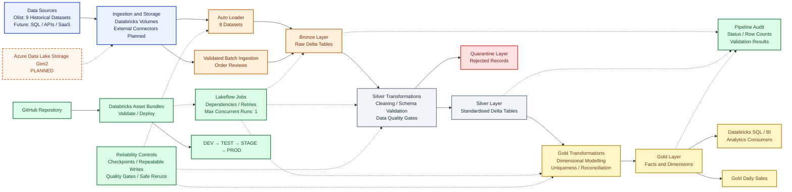
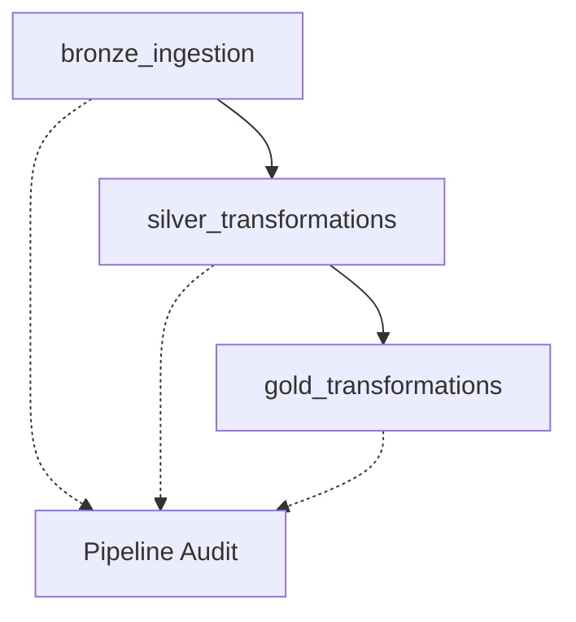

# Production-Grade E-Commerce Lakehouse on Azure Databricks

**An end-to-end data engineering project demonstrating Medallion Architecture with Apache Spark, Delta Lake, Databricks Auto Loader, Unity Catalog, Lakeflow Jobs, data-quality controls, audit logging, and Databricks Asset Bundles.**

## End-to-end data flow



**Architecture status:** The implemented pipeline processes the nine historical Olist datasets using Databricks-managed Volumes, Auto Loader for eight datasets, and validated batch ingestion for order reviews. It includes Bronze/Silver/Gold transformations, quarantine handling, quality gates, audit logging, Lakeflow Jobs, and Databricks Asset Bundle targets for DEV, TEST, STAGE, and PROD. External SQL/API/SaaS connectors and ADLS Gen2 remain planned extensions. Full recovery from every partial-failure scenario has not been independently verified.

## Project documentation

For detailed design decisions and implementation notes, see [Project Technical Documentation](docs/PROJECT_DOCUMENTATION.md).

## Table of contents

- [Overview](#overview)
- [Business problem](#business-problem)
- [Project objectives](#project-objectives)
- [System design](#system-design)
- [Technology stack](#technology-stack)
- [Data sources](#data-sources)
- [Medallion architecture](#medallion-architecture)
- [Data modelling](#data-modelling)
- [Data quality and reliability](#data-quality-and-reliability)
- [Pipeline orchestration](#pipeline-orchestration)
- [Monitoring and audit](#monitoring-and-audit)
- [Repository structure](#repository-structure)
- [Environment and deployment](#environment-and-deployment)
- [Validation and testing](#validation-and-testing)
- [Implementation status](#implementation-status)
- [Future enhancements](#future-enhancements)
- [Getting started](#getting-started)
- [Author](#author)

---

## Overview

This project demonstrates an e-commerce Lakehouse built with Azure Databricks and Delta Lake. It ingests historical source files, preserves raw data, applies cleansing and business validation, quarantines rejected records, and publishes analytical tables for reporting.

The project uses the Brazilian Olist e-commerce dataset, which contains customer, order, product, seller, payment, review, geographic, and product-category information.

The architecture follows the Medallion pattern:

- **Bronze:** source-aligned ingestion into Delta tables.
- **Silver:** cleansing, standardisation, validation, and quarantine.
- **Gold:** dimensional models and business-level aggregations.

Lakeflow Jobs orchestrates the Bronze → Silver → Gold workflow. A Delta audit table records execution and dataset-level metrics. GitHub and Databricks Asset Bundles provide source control and job deployment configuration.

### Key capabilities

- Auto Loader ingestion for eight datasets.
- Dedicated batch ingestion and validation for multiline review CSV data.
- Delta tables across Bronze, Silver, and Gold.
- Schema, business-key, and referential-integrity checks.
- Quarantine handling for rejected records.
- Separate fact tables for order items, payments, and reviews.
- Daily sales aggregation and delivery-related metrics.
- Pipeline audit logging with row counts and validation status.
- Lakeflow Jobs with task dependencies, retries, and concurrency control.
- Bundle targets for DEV, TEST, STAGE, and PROD.

## Business problem

E-commerce systems produce data across customers, orders, products, sellers, payments, reviews, and logistics. Without a structured platform, inconsistent schemas, incomplete records, duplicate keys, and incorrect joins can reduce the reliability of business reporting.

This project creates a repeatable pipeline that turns raw datasets into validated analytical tables while retaining traceability and visibility into data-quality issues.

The resulting models can support questions such as:

- How do order volumes and sales values change over time?
- Which payment methods contribute the most payment value?
- How do delivery outcomes vary across orders?
- How are customers, products, and sellers represented in analytical models?
- Where do data-quality issues occur, and how can they be investigated?

## Project objectives

1. Build a repeatable end-to-end ingestion and transformation pipeline.
2. Implement Bronze, Silver, Gold, and Quarantine layers.
3. Apply schema validation, business rules, and data-quality gates.
4. Preserve traceability from source data through analytical outputs.
5. Build fact and dimension tables for business intelligence.
6. Prevent joins across different transaction grains from multiplying monetary values.
7. Orchestrate dependent tasks with Lakeflow Jobs.
8. Record execution and validation results centrally.
9. Manage job deployment configuration through Git and Databricks Asset Bundles.
10. Establish a foundation for incremental processing, recovery testing, and cloud-storage integration.

## System design

The platform has five logical areas:

1. **Sources:** the historical Olist CSV datasets.
2. **Ingestion and storage:** Databricks Volumes, Auto Loader, and a specialised review-ingestion path.
3. **Lakehouse processing:** Bronze, Silver, Gold, and Quarantine tables.
4. **Consumption:** curated fact tables, dimensions, and daily sales aggregates.
5. **Operations and delivery:** Lakeflow Jobs, audit logging, Unity Catalog, GitHub, and Databricks Asset Bundles.

External databases, REST APIs, SaaS sources, and ADLS Gen2 are possible extensions, not part of the currently implemented Olist ingestion path.

## Technology stack

| Category | Technology | Purpose |
|---|---|---|
| Processing | Python, Apache Spark, PySpark | Data ingestion and transformation |
| Lakehouse | Azure Databricks, Delta Lake | Processing and transactional tables |
| File ingestion | Databricks Auto Loader | Incremental file discovery and checkpointing |
| Architecture | Medallion Architecture | Separation of raw, cleansed, and analytical data |
| Data modelling | Fact and dimension tables | Business-ready analytical structures |
| Orchestration | Databricks Lakeflow Jobs | Dependencies, retries, and scheduling |
| Governance | Unity Catalog | Data organisation, access control, and metadata |
| Monitoring | Delta audit table, SQL validation queries | Execution tracking and data-quality visibility |
| Version control | Git, GitHub | Source control and change management |
| Deployment | Databricks Asset Bundles | Bundle validation and workspace deployment |
| Planned infrastructure | ADLS Gen2, Terraform | Cloud storage and infrastructure automation |

## Data sources

The project uses nine historical Olist datasets:

| Dataset | Business domain |
|---|---|
| `olist_customers_dataset.csv` | Customer records |
| `olist_geolocation_dataset.csv` | Geographic information |
| `olist_order_items_dataset.csv` | Items associated with orders |
| `olist_order_payments_dataset.csv` | Payment transactions |
| `olist_order_reviews_dataset.csv` | Customer reviews |
| `olist_orders_dataset.csv` | Order lifecycle and timestamps |
| `olist_products_dataset.csv` | Product attributes |
| `olist_sellers_dataset.csv` | Seller records |
| `product_category_name_translation.csv` | Product-category translations |

These are historical files, not a live change-data-capture stream. The current implementation uses Auto Loader for eight datasets and a validated batch rebuild for order reviews because review comments can contain multiline CSV data.

Future source integrations could include SQL Server or other relational databases, REST APIs, and SaaS platforms. Each would require an appropriate, configured, secured, and tested connector. CDC should only be claimed where supported and implemented for the selected source.

## Medallion architecture

### 1. Bronze — raw ingestion

**Development schema:** `de_dev.bronze`

Bronze preserves source-aligned data in Delta tables and retains relevant ingestion metadata.

Implemented capabilities include:

- Auto Loader for eight datasets.
- Stable checkpoint paths for file-processing state.
- Available-now ingestion execution.
- Source-file and ingestion metadata where configured.
- Rescued-data handling where configured.
- Dedicated review staging, validation, and publishing logic.
- Review validation before replacing the published Bronze table.

The nine Bronze tables are:

- `olist_customers`
- `olist_geolocation`
- `olist_order_items`
- `olist_order_payments`
- `olist_order_reviews`
- `olist_orders`
- `olist_products`
- `olist_sellers`
- `product_category_translation`

The review-ingestion workflow validates the expected 99,224 records and checks the composite key `(review_id, order_id)` before publishing.

### 2. Silver — cleansing and standardisation

**Development schema:** `de_dev.silver`

Silver applies standardisation, validation, and business rules before downstream Gold processing.

Implemented capabilities include:

- Data cleansing and standardisation.
- Schema and business-rule validation.
- Duplicate-key and referential-integrity checks.
- Quarantine tables for rejected records.
- Quality gates before downstream processing.
- Full-refresh table writes.

The current Silver process rebuilds tables using overwrite operations. Incremental `MERGE` processing for changed or late-arriving records is a future enhancement.

Previously verified development row counts:

| Dataset | Rows |
|---|---:|
| Orders | 99,441 |
| Order items | 112,650 |
| Customers | 99,441 |
| Products | 32,951 |
| Sellers | 3,095 |
| Payments | 103,886 |
| Reviews | 99,224 |
| Geolocation | 1,000,163 |
| Category translations | 71 |

These are historical validation results, not a guarantee that future runs will have identical counts if source data or processing logic changes.

### 3. Quarantine — rejected records

**Development schema:** `de_dev.quarantine`

Quarantine stores records rejected by applicable validation rules so they can be investigated without silently mixing invalid records into trusted analytical outputs.

The current implementation includes quarantine handling in Silver transformations. Automatic replay of corrected records and a complete operational remediation workflow remain future enhancements.

### 4. Gold — business-ready data

**Development schema:** `de_dev.gold`

Gold contains dimensional and analytical tables for reporting and downstream consumption.

#### Dimensions

| Table | Description |
|---|---|
| `dim_customer` | Customer dimension |
| `dim_product` | Product dimension |
| `dim_seller` | Seller dimension |

#### Fact tables

| Table | Grain |
|---|---|
| `fact_order_items` | One record per `(order_id, order_item_id)` |
| `fact_order_payments` | One record per `(order_id, payment_sequential)` |
| `fact_order_reviews` | One record per source review record, with a generated review-row key |

#### Aggregation

| Table | Description |
|---|---|
| `gold_daily_sales` | Daily sales metrics grouped by purchase date and order status |

Order-item and payment facts are maintained separately to prevent joins between multiple items and multiple payments from multiplying monetary values.

Gold transformations include uniqueness checks and row-count reconciliation against Silver source datasets. Current Gold writes use full-refresh overwrites; incremental `MERGE` operations are not yet implemented.

Previously verified Gold row counts:

| Gold table | Rows |
|---|---:|
| `dim_customer` | 99,441 |
| `dim_product` | 32,951 |
| `dim_seller` | 3,095 |
| `fact_order_items` | 112,650 |
| `fact_order_payments` | 103,886 |
| `fact_order_reviews` | 99,224 |
| `gold_daily_sales` | 1,783 |

## Data modelling

The analytical model separates transaction grains to preserve correct aggregation behaviour.

### Order items

The order-item fact uses `(order_id, order_item_id)` as its composite key. It includes order context, product and seller relationships, pricing, freight, and delivery-related metrics.

### Payments

The payment fact uses `(order_id, payment_sequential)`. This allows multiple payment records per order to remain distinct.

### Reviews

The review fact preserves source review records. The composite source key `(review_id, order_id)` is important because a review ID can occur across different orders in the source data.

### Daily sales

`gold_daily_sales` aggregates order-item data by purchase date and order status. Measures include order counts, item counts, product revenue, freight value, item-plus-freight value, average item price, and an average late-delivery indicator.

The aggregate has fewer rows than the order-item fact because it represents grouped data rather than individual items.

## Data quality and reliability

The pipeline uses validation rules and quality gates to catch inconsistencies before data reaches Gold.

### Implemented validation

- Business-key uniqueness.
- Schema and data validation.
- Referential-integrity checks.
- Quarantine handling.
- Review-record validation before publishing.
- Source-to-output row-count reconciliation.
- Payment and order-item fact-grain validation.

A previously verified payment fact contained:

| Metric | Result |
|---|---:|
| Payment records | 103,886 |
| Distinct `(order_id, payment_sequential)` keys | 103,886 |
| Duplicate payment keys | 0 |
| Zero-value payment records | 9 |
| Undefined payment types | 3 |

Zero-value and undefined payment records were retained for investigation rather than automatically deleted. Data anomalies should be distinguished from pipeline failures.

### Idempotency and recovery

The implementation uses Auto Loader checkpoints, repeatable full-refresh Silver and Gold writes, business-key checks, and a review staging-and-validation workflow. Normal reruns and a duplicate-file test were reported as successful during development.

Full recovery from partial failures has not been independently verified. Incremental updates, late-arriving data, and duplicate content arriving under new filenames require additional scenario-specific testing before stronger guarantees can be claimed.

## Pipeline orchestration

Lakeflow Jobs orchestrates the pipeline in dependency order:



### Job configuration

| Setting | Configuration |
|---|---|
| Job name | `ecommerce_lakehouse_${bundle.target}` |
| Execution order | Bronze → Silver → Gold |
| Maximum concurrent runs | 1 |
| Task retries | 1 retry per task |
| Compute | Serverless environment |
| Environment version | 2 |
| Schedule | Configured for 06:00 Europe/Amsterdam; verify enabled status in each target |

A configured retry policy does not prove that every partial-failure scenario recovers safely. Scheduled execution should be confirmed in job run history after the schedule triggers.

## Monitoring and audit

The pipeline writes audit records to an environment-specific Delta table, for example:

`de_dev.monitoring.pipeline_audit`

The audit framework records fields including:

- Audit ID.
- Pipeline and task names.
- Environment.
- Dataset and processing layer.
- Execution status.
- Start and end timestamps.
- Duration.
- Source and output row counts.
- Quarantined row counts.
- Validation status.
- Error message, where provided.

Successful audit records have been verified for Bronze, Silver, and Gold processing, including the seven Gold outputs.

Complete failure auditing, job-run-ID correlation, accurate per-table execution timing, and automated notifications require further verification or enhancement.

## Repository structure

```text
databricks-ecommerce-lakehouse/
├── databricks.yml
├── resources/
│   └── ecommerce_pipeline.yml
├── notebooks/
│   └── development/
│       ├── bronze_ingestion.py
│       ├── silver_transformations.py
│       ├── gold_transformations.py
│       └── pipeline_audit.py
├── docs/
│   ├── Architecture.png
│   └── PROJECT_DOCUMENTATION.md
└── README.md
```

Ensure the image and documentation paths match the actual filenames and casing in the repository.

## Environment and deployment

The bundle is configured with four target catalogs:

| Target | Catalog |
|---|---|
| DEV | `de_dev` |
| TEST | `de_test` |
| STAGE | `de_stage` |
| PROD | `de_prod` |

The deployment workflow was run across all four targets during project setup. Deployment success alone does not prove that every environment has complete data, successful pipeline runs, appropriate access controls, or production readiness. Validate the job run history and environment-specific tables before relying on each target.

### Prerequisites

- Access to a Databricks workspace.
- Databricks CLI configured with an approved authentication method.
- Git access to the repository.
- Permissions to deploy the bundle and create or use required catalogs, schemas, and volumes.
- Access to the relevant raw files in each environment.

### Clone the repository

```bash
git clone https://github.com/fay-cloud/databricks-ecommerce-lakehouse.git
cd databricks-ecommerce-lakehouse
```

Authenticate the Databricks CLI using your workspace's approved authentication method.

### Validate and deploy

Validate and deploy one target at a time:

```bash
databricks bundle validate -t dev
databricks bundle deploy -t dev
```

For another environment, replace `dev` with `test`, `stage`, or `prod`. Confirm the target catalog and deployment configuration before deploying.

### Run the pipeline

```bash
databricks bundle run -t dev ecommerce_pipeline
```

The job executes Bronze, Silver, and Gold in dependency order. Check the resulting job run and task statuses in the Databricks UI.

### Version control workflow

Review local changes before committing:

```bash
git status
git branch --show-current
git pull --ff-only origin main
```

After making and testing a code change, stage only the intended files:

```bash
git add resources/ecommerce_pipeline.yml notebooks/development/
git commit -m "Describe the pipeline improvement"
git push origin main
```

Review staged changes before committing to avoid including unrelated files. For deployment changes, validate the bundle, deploy the intended target, and verify the resulting job configuration and run.

## Validation and testing

Previously recorded development evidence includes:

| Validation area | Evidence |
|---|---|
| End-to-end orchestration | Bronze, Silver, and Gold tasks completed successfully in prior runs |
| Silver transformations | Dataset counts and quality gates verified |
| Gold transformations | Seven Gold outputs and successful audit records verified |
| Payment fact uniqueness | 103,886 records and 103,886 distinct composite keys |
| Order-item fact uniqueness | 112,650 records verified in prior validation |
| Review ingestion | 99,224 records validated in the review publishing workflow |
| Audit integration | Successful dataset-level and overall records verified |
| Bundle validation | Development validation succeeded |
| Bundle deployment | Development deployment succeeded |
| Environment targets | Bundle targets configured for DEV, TEST, STAGE, and PROD |

These results describe previously verified runs. A fresh run may differ if source data or code changes. Keep job run links and logs as evidence for future troubleshooting and project documentation.

## Implementation status

| Capability | Status |
|---|---|
| Medallion architecture | Implemented |
| Bronze ingestion for nine datasets | Implemented using two ingestion approaches |
| Auto Loader for eight datasets | Implemented |
| Specialised review ingestion | Implemented |
| Silver transformations and quarantine | Implemented |
| Gold dimensions, facts, and daily sales | Implemented |
| Data-quality checks and business-key validation | Implemented and tested |
| Pipeline audit logging | Implemented; successful records verified |
| Lakeflow Job orchestration | Configured and executed |
| DEV, TEST, STAGE, PROD bundle targets | Configured and deployment attempted successfully |
| Normal rerun stability | Verified in development |
| Complete partial-failure recovery | Not independently verified |
| Incremental Silver and Gold `MERGE` | Planned |
| Full late-arriving data and change-handling workflow | Planned |
| ADLS Gen2 integration | Planned |
| SQL Server, REST API, and SaaS source connectors | Planned |
| Automated failure notifications | Planned or requires verification |
| Complete CI/CD promotion controls | Requires further implementation and verification |
| Production operational readiness | Requires environment-specific verification |

## Future enhancements

1. **Incremental processing:** introduce Delta `MERGE` where appropriate, with tested rules for updates, replays, and late-arriving data.
2. **Cloud storage:** integrate ADLS Gen2 using appropriate identity, permissions, and Unity Catalog external locations or volumes.
3. **Additional sources:** implement and test connectors for selected databases, REST APIs, and SaaS platforms; document authentication, rate limits, pagination, incremental extraction, and source-specific limitations.
4. **Operational monitoring:** strengthen failure auditing, job-run correlation, alerting, and pipeline-freshness checks.
5. **Recovery testing:** validate retries and safe recovery from partial failures.
6. **CI/CD promotion:** implement and verify controlled promotion through development, test, stage, and production.
7. **Business analytics:** expose Gold datasets through Databricks SQL and build reporting dashboards.
8. **Infrastructure as Code:** provision and manage cloud resources with Terraform where appropriate.
9. **Governance and security:** strengthen access controls, lineage, secrets management, and PII handling.

The historical Olist dataset is the foundation for the current pipeline. Incremental and CDC-like behaviour must be simulated or tested with a changing source dataset, and documented as such.

## Getting started

To explore the project:

1. Review the architecture diagram.
2. Inspect `notebooks/development/bronze_ingestion.py` for ingestion and checkpointing.
3. Review `notebooks/development/silver_transformations.py` for cleansing, validation, and quarantine.
4. Review `notebooks/development/gold_transformations.py` for dimensional modelling and analytical aggregations.
5. Inspect `notebooks/development/pipeline_audit.py` and the monitoring table for traceability.
6. Review `resources/ecommerce_pipeline.yml` for dependencies, retries, and scheduling.
7. Validate and deploy the bundle in an authorised development workspace.

Use the current implementation as the reference point when assessing planned enhancements.

## Author

**Fayomi K. A.**

Data Engineer | Python | SQL | Apache Spark | Azure Databricks | Delta Lake | Data Modelling | Data Quality | Pipeline Orchestration

- GitHub: [fay-cloud](https://github.com/fay-cloud)
- Repository: [databricks-ecommerce-lakehouse](https://github.com/fay-cloud/databricks-ecommerce-lakehouse)
